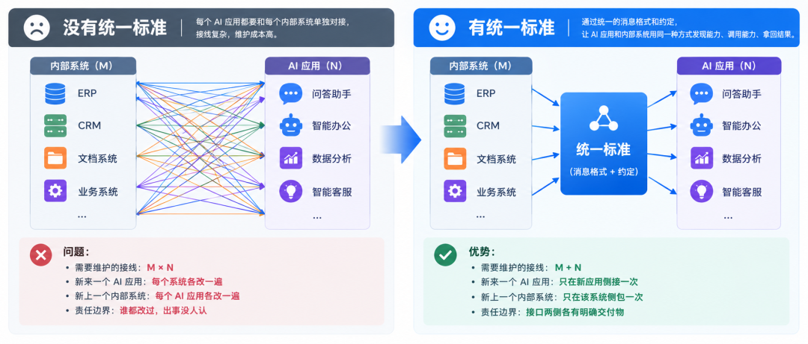
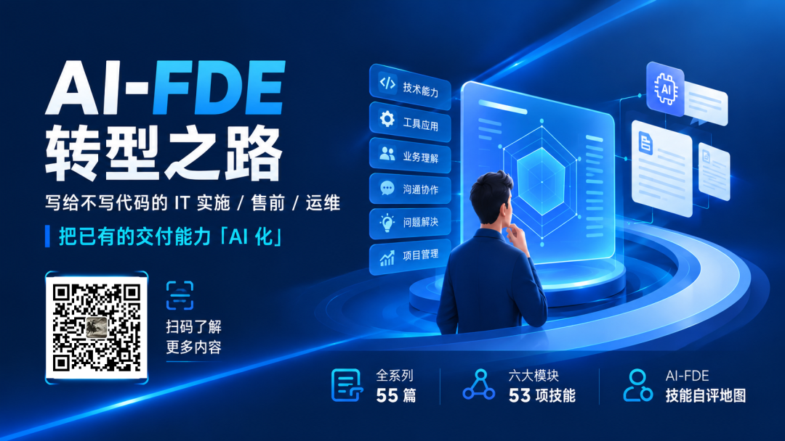

## 1. MCP isn't a new trick the model learned; it's a USB port

**MCP does not make the model smarter. Its entire value is one sentence: it connects internal systems through a USB-style port.**

A little history. MCP is an open specification published and open-sourced by Anthropic in November 2024. In December 2025 it was donated to the **Agentic AI Foundation** under the Linux Foundation (founded by Anthropic, Block and OpenAI, with support from Google, Microsoft, AWS, Cloudflare and Bloomberg); MCP was one of its founding projects. The official numbers: more than **10,000** publicly available MCP servers, **97 million** monthly SDK downloads, and support from ChatGPT, Claude, Cursor, Gemini, Microsoft Copilot and VS Code.

The foundation matters to both customers and vendors: the standard is no longer owned by one company. It has to work as a general standard.

Here is the plain-language definition: **it defines a standard way for an AI application to discover "what capabilities exist here", call them, and get results back.** Technically it runs on JSON-RPC 2.0. You don't need to remember that detail. Just know that it is **a message format plus a set of conventions**, not a product and not a feature of a particular model.

The problem it solves is a multiplication problem. An organization has M internal systems and N AI applications. Connecting every pair directly means M×N links. With one common interface, it becomes M+N.

| What you look at | Without a common standard | With a common standard |
| --- | --- | --- |
| Links to maintain | M × N | M + N |
| A new AI application arrives | Change every system | Integrate once on the new application side |
| A new internal system arrives | Change every AI application | Wrap once on that system's side |
| Responsibility boundary | Everyone touched it; nobody owns the failure | Each side has a clear deliverable |



Engineer Li once asked me something I still remember: "You need me to cooperate on this Q&A integration. When the next AI application comes, do we do it all over again? How many times a year?" The answer to that question is what this article is about.

## 2. MCP has three roles and three kinds of things

First the roles. The specification calls them Host / Client / Server. Here is how I map them onto a bank project:

| Role | Name in the specification | What it is in a project |
| --- | --- | --- |
| **Host** | The AI application that initiates the connection | The Q&A interface or assistant used by employees |
| **Client** | The component inside the host that manages the connection | The connection inside that interface that says "connect to the credit system" |
| **Server** | The service that provides context and capabilities | The layer we wrap, with the credit system behind it |

There is a mental block many people hit here: **the Server is not your bank's legacy system.** The Server is a coat worn over the legacy system. The legacy system does not change a single line; the Server speaks on its behalf. So "wrap it as an MCP Server" is never a legacy-system rewrite. It is adding a translator.

Next, what a Server can provide. The specification has exactly three things, no more:

| The three things | What they are | Who decides whether to use them | Example at Hengxin Bank |
| --- | --- | --- | --- |
| **Tools** | Functions that can be called and that return results or cause actions | The model decides (which is why you must write good descriptions) | Check a credit approval status; calculate an available credit line |
| **Resources** | Data that can be read, such as files and records | The application or the user chooses; the model does not read them on its own | Policy documents, product catalog, customer files |
| **Prompts** | Predefined message templates and workflows | The user picks one | "Produce a checklist using the credit-material pre-review standard" |

Remember the division: **Tools act; Resources provide reading material.** The most common beginner mistake is to turn everything into a Tool — even policy documents become a "read policy" tool, so the model has to "decide whether to read" every time. It is slower and it reads the wrong things. **Reference material should be a Resource. Only actions deserve to be Tools.**

One more capability is worth knowing: a Server can ask for more information (the specification calls it elicitation — for example, "which customer do you want to check?"), and the Client asks the user and brings the answer back. This is useful in banking: "if the material is incomplete, ask instead of guessing" can become a protocol-level action, rather than a prompt begging the model not to hallucinate.


## 3. MCP and tool calling are not the same thing, and neither replaces the other

This is probably the most important distinction in the article, because the two terms are mixed up every day. Once they are mixed up, you get questions like "if we adopt MCP, will the model get better at calling tools?"

**Tool calling (also called function calling) solves "how does the model express that it wants to call a function?"** The model emits structured arguments, the host executes the call, and the result is fed back (we took the mechanism apart in article 06). This is a **model-side capability**. Change vendors or models and the mechanism is broadly the same.

**MCP solves "where do these tools come from, what exists, how are they discovered, and how are they called?"** It manages **supply and connection**: a Server declares its Tools / Resources / Prompts, the Client lists them, and the host turns them into a set of tools the model can choose from.

So the real chain is layered:

Business problem → Agent or application → get the capability list from the MCP Server → hand the list to the model in tool-calling format → the model picks one and supplies arguments → the host executes it (very likely against the MCP Server) → the result goes back → repeat.

**The one-sentence summary: MCP does not decide for the model; it standardizes what can be called.**

An analogy. Tool calling is **how you order a dish** — you have to say "one beef noodle soup, no cilantro" before the kitchen can make it right. MCP is **the common specification that lets every restaurant in a mall connect to a delivery platform** — anyone can join, the menu format is the same, and the platform does not rewrite an integration for each restaurant. How to order is one thing; the specification is another. You need both, but neither substitutes for the other.

| What you look at | Tool calling | MCP |
| --- | --- | --- |
| Problem solved | How the model expresses "call what, with which arguments" | Where tools come from, what exists, how they are called |
| Layer | Model / inference side | Integration / connection side |
| Who defines it | Each model vendor's API | An open specification, now hosted by a foundation |
| Does it make the model smarter? | No. It just lets it act | No. It just makes integration cheaper |
| Can you skip it? | No. The model can only chat | Yes, but every application and system integrates separately |
| Where in this series | Article 06 | This article |

Let's put the Agent into the same picture and settle all three at once: **an Agent is the loop that decides what to do next, tool calling is how it speaks, and MCP is where its tools come from.** You can omit one: you can build an Agent without MCP by hard-coding tools. But a model without tool calling cannot be an Agent.

## 4. Whether to wrap comes down to three questions

My judgment: **the hard part of MCP is not "can you wrap it" but "is it worth wrapping".** Most internal projects fail on the second question — they add a layer because it looks technically elegant, and then inherit something they must maintain forever.

Ask three questions in order:

1. **Is there a second caller, or will there be one next year?** If there is only one AI application and it calls one endpoint, call it directly. Wrapping it in MCP is just an extra layer. If Q&A, contract review and agent-assist all need to query the same system, the layer pays for itself immediately.

2. **Will this system be integrated repeatedly?** If every integration has to redo authentication, parameter mapping and response trimming, it is worth wrapping. If the interface is simple and gets integrated once every few years, it is not.

3. **Will other people use it?** If the Server will be used by other teams or even external vendors' AI systems, the standardization pays off immediately. If only your own team will ever use it, discount the benefit.

There is a counter-question too: **be very careful with write operations.** Wrapping read-only queries is manageable. "Submit a ticket", "initiate a payment" or "adjust a credit limit" put an action-capable interface in the hands of a model that makes mistakes. You can still do it, but none of the four gates in the next section can be skipped.

I was taught this lesson early. I once thought "wrap everything in MCP; it's cleaner." So I wrapped a tiny endpoint that queried one table. After launch, every investigation required checking the gateway, then the MCP service, then the legacy system — three hops. **One more layer means one more place that can fail and one more place to watch.** Whether the layer should exist is answered by the three questions above, not by technical taste.

## 5. Wrapping is not delivery: four gates you must pass

This article does not expect you to write a service from scratch; that is not this role's job. But standards have to land on something concrete, so the next section gives you twenty-odd lines that actually run. First, **four acceptance criteria** (a sample checklist; calibrate it to your project):

1. **Does it reuse the existing system or create a new one?** Does authentication plug into the bank's existing system? If the answer is "we created a new account system", that will not pass review at a bank customer. The specification already defines a full set of authorization approaches; you don't need to invent one, but you must ask the engineer which one they chose.

2. **Does changing one system require changing the others?** When you add a capability, do you add it only to this Server, or must every AI application change? Only the former is a middle layer. The latter merely moves the coupling somewhere else.

3. **Does every call leave a trace?** Who, when, what was called, with which arguments, and what was the result? The trace must land in the customer's existing audit system, not only in application logs. We will hit the "single audit entry point" again in article 14, when we discuss the AI Gateway.

4. **Can you turn it off with one switch?** When something goes wrong, is there a switch that immediately stops its calls to internal systems without affecting other business? At a financial customer this is mandatory. It can save you during an incident.

One more point for anyone who will talk to engineers: **a Server saying it is "read-only" does not mean it is actually read-only.** The specification does have fields for annotating tool behavior, but the server fills them in itself. The specification explicitly warns that tool descriptions and similar information should be **treated as untrusted when the source is untrusted**. Likewise, the specification states as a principle that "the user must explicitly consent before a tool is invoked", but it also admits that these safety principles **cannot be enforced at the protocol level**; they depend on the implementer. In customer language: **do not trust declarations; look at the implementation and the audit trail.** That is why gate three is harder to fake than gate one.

**Hands-on task:** pick the internal system you integrate most often and draw a diagram of "how AI calls it today", marking where authentication, transformation and logging happen. Then answer two questions. If you add one more AI application, how many lines must be redrawn? If you wrap it as an MCP Server, which of the four gates will block you first?

## 6. The real thing is twenty-odd lines; you need to understand four things

One pitfall first: **the official Python SDK is already at v2**, and the class is `MCPServer`. A lot of tutorials online still show the v1 `FastMCP` style. Copy them and the errors start on line one. **This proves the pitfall in section 7: versions must be written down, not left to "everyone online says".** Pay attention to the MCP server and client versions; keep them aligned if possible. Sometimes they depend on specific versions of other packages. After the rapid-growth phase, this should settle down.

Here is a complete, working example:

```python
from mcp.server import MCPServer
from mcp.server.mcpserver.exceptions import ToolError

mcp = MCPServer("credit-query", instructions="Read-only queries. Do not modify any data.")

_DB = {                                            # 1. Where the data comes from
    "C001": {"name": "Hengxin Machinery Manufacturing", "limit": 800.0, "used": 620.0},
    "C002": {"name": "Hengxin Building Materials", "limit": 300.0, "used": 285.0},
}

@mcp.tool()                                        # 2. Declaration: this is a tool
def query_credit(customer_id: str) -> dict:
    """Return the total and used credit line for a customer ID. Read-only; no data is modified.

    customer_id: customer ID, for example C001.
    """
    row = _DB.get(customer_id)
    if row is None:                                # 3. How to report failure
        raise ToolError(f"Customer ID {customer_id} does not exist")
    return {"customer_id": customer_id, **row,
            "available": row["limit"] - row["used"]}

if __name__ == "__main__":
    mcp.run()                                      # 4. How to run: stdio by default
```

Four things you must understand and be able to ask about:

| Location | What the code does | What you should ask the engineer |
| --- | --- | --- |
| 1. Where the data comes from | Fake data now; in a real project, replace it with a call to the legacy system | Which account does it use? What is the timeout? How are missing fields returned? |
| 2. Declaration | `@mcp.tool()` plus a function | **Is the tool description clear?** The `"""` block is the "manual" from article 06, passed to the model verbatim |
| 3. How to report failure | `raise ToolError(...)`, not `return "query failed"` | Is failure raised, or swallowed by a `try` and disguised as success? This determines whether audit can find the problem |
| 4. How to run | `mcp.run()` defaults to stdio | Multiple users on the intranet need Streamable HTTP; who approves the port, certificate and gateway? |

Point 2 deserves more detail because it is where this article bites into article 06. **The function description you write is everything the model sees.** In a real test, the server listed the tool like this:

```text
Tool name: query_credit
Description: Return the total and used credit line for a customer ID. Read-only; no data is modified.
Parameters: {"properties": {"customer_id": {"type": "string"}}, "required": ["customer_id"]}
```

The parameter list is not written by hand. It is generated from the `customer_id: str` annotation. So whether the tool is called correctly depends partly on whether the description is accurate. **Vague description, random calls. Clear "read-only", and it will not use it to change data.** Conversely, if the description lies (it writes to the database but claims read-only), you land directly on section 5's "do not trust declarations".

Installation is one line: `pip install "mcp[cli]"`. For an intranet machine, go back to the offline packaging approach in article 07. Bring the wheels with you; don't discover at the customer's data center that you cannot install anything.

There are two ways to run it, depending on site conditions:

- **Node available:** `mcp dev server.py` starts a web-based Inspector. You can see the tool list, fill in parameters and inspect results. This is the most intuitive acceptance method, and it looks professional in a customer demo.

- **No Node on the intranet:** write a dozen lines of client code as the caller (`from mcp import Client, StdioServerParameters`, then `list_tools()` and `call_tool()` inside `async with Client(...)`). I have used this to verify two things: a normal call returns structured data; and **deliberately passing a nonexistent customer ID returns `is_error=True` with an error message instead of crashing the client**. Tool errors must not take down the host. Test this explicitly.

## 7. Pitfalls

**Treating stdio as "deployed on a server".** This is the most common accident in the field. A stdio Server is a child process launched by the host on the same machine; it lives and dies with that computer. Someone installs it on an application server as a shared service and the next day the whole bank cannot connect — because no "local machine" is running it. For shared use, use Streamable HTTP (a single HTTP endpoint) and plan the port, certificate and gateway together. **Choosing the wrong transport is the most common rework in this area.** One related discipline: **with stdio, stdout is the wire.** The v2 SDK redirects stdout emitted during the service to stderr, but output **before the service starts**, and `print()` calls that are buffered until the process exits, still land on the wire. The host sees "failed to parse message; service not responding". So log with `logging`, never `print`.

**Starting before the versions are aligned.** By July 2026 MCP had five versions: 2024-11-05 → 2025-03-26 → 2025-06-18 → 2025-11-25 → 2026-07-28. And the changes are not small. For example, **the 2026-07-28 version removed the `initialize` handshake entirely**, replacing it with per-request version and capability information. The old HTTP+SSE transport and the Roots, Sampling and Logging features were all put on the deprecation list (with a **minimum 12-month** deprecation window). So a contract or proposal must state "which version we implement". If each side implements half of a different version, they will not recognize each other during integration, and this kind of error often does not show up in the test environment.

**Running the Server with a super account.** Using a high-privilege account for convenience bypasses the bank's entire permission system. The logs are all under that account, and you cannot tell who did what. The correct approach is to pass the caller's identity through and let the legacy system apply its own rules again. **That is what "reuse authentication" means.**

**Wrapping dozens of capabilities at once.** I prefer to wrap one first: the most representative and most frequently called one or two. Get them working, then expand. If you lay out too much at once, testing, permission review and documentation will crush you. Also, the more tools there are, the higher the chance the model picks the wrong one (the "no more than ten in one decision layer" rule from article 06 still applies).

Back to Engineer Li's question: when the next AI application arrives, do we integrate again? With this layer, the answer is "the system does not reconnect; it connects to this layer instead." But that answer only holds if you can answer four things: whose permissions it reuses, how large the blast radius is, which calls stop when you turn it off, and which version it implements. If you can explain those four, you can accept the delivery — instead of merely signing the acceptance form.

* * *

**The AI-FDE Transition Path**: for IT implementation, pre-sales and operations people who don't write code, turning existing delivery skills into AI skills. The full series has 55 articles across six modules and 53 skills.

Want to see what you're missing first? The AI-FDE skill self-assessment map scores 53 items and produces a radar chart. [The AI-FDE Transition Path · Introduction](/docs/00-intro/)


